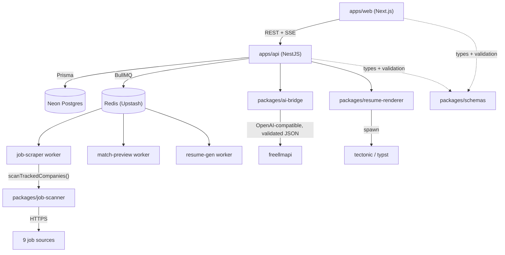
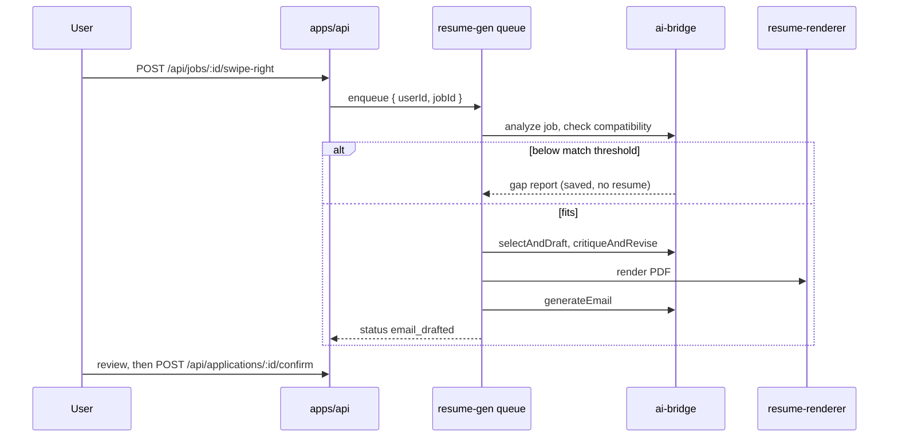

# Resumiq

(repo: resumiq-job-match-resume-engine)

*Scans job boards, scores each posting against your career profile, and drafts a tailored resume and outreach email for the ones that fit.*


[Live app](https://resume-web-six-black.vercel.app) · [API](https://resume-4kci.onrender.com)

A tailored resume per application is a lot of rewriting, and a career history that lives across an old resume, a LinkedIn export and memory gives a program nothing to select from. Resumiq starts by turning pasted career text into a typed profile (experience, education, projects, skills, certifications, awards), then works from that profile for everything else.

From the profile it runs a pipeline: a daily scan of nine job sources, an LLM job analysis, a compatibility score, and, above a threshold, a resume selection and rewrite that renders to PDF with LaTeX (tectonic) or Typst. Below the threshold it produces a gap report instead of a resume. A swipe deck over scanned jobs triggers the same pipeline in a background queue, so a swipe right ends with a resume and an email draft waiting for review. The app never sends email itself: `confirm` only marks an application `ready`.

Every LLM call returns JSON that is validated against a shared Zod schema, with one repair re-prompt on failure. Providers are reached through [freellmapi](https://github.com/tashfeenahmed/freellmapi), a proxy that routes across free-tier models behind one OpenAI-compatible endpoint, so the app holds no per-provider key rotation logic.

## Measured: LLM output validation

The five core agents (`analyzeJob`, `checkCompatibility`, `selectAndDraft`, `generateEmail`, `parseJobIntake`) validate their output against the schema their consumer uses, and retry once with the Zod error included in the prompt. Measured with real calls through freellmapi (model `auto`, temperature 0.4), 20 trials per agent, same inputs for both numbers:

| Agent | Trials | Malformed on first reply | Valid after validation + 1 repair |
| --- | --- | --- | --- |
| analyzeJob | 20 | 0 | 20 |
| checkCompatibility | 20 | 0 | 20 |
| selectAndDraft | 20 | 17 | 20 |
| generateEmail | 20 | 0 | 20 |
| parseJobIntake | 20 | 0 | 20 |
| Total | 100 | 17 | 100 |

Valid outputs went from 83% to 100%. All 17 failures were one defect, `selectAndDraft` returning `"summary": null` where the schema wants a string or nothing, and the repair retry fixed every one. Read this with its limits: one run, a synthetic profile with no stored summaries (which is what provokes the `null`), five hand-written job descriptions, and a rotating free-tier model pool, so it shows that the failure mode exists and is cheap to repair, not a production rate. The script is `apps/api/scripts/measure-llm-shapes.ts` and needs a `FREELLMAPI_API_KEY`.

## Features

**Career profile** — pasted text is parsed by an LLM into typed sections, streamed over SSE with a heartbeat, then confirmed by the user in a separate step. Manual add, edit and delete per entry, JSON import and export, and a 0-100 strength score.

**Job discovery** — a BullMQ job scans `tracked-companies.json` daily at 03:00 across nine sources: Greenhouse, Lever, Ashby, Workday, SmartRecruiters, RemoteOK, Himalayas, Remotive and We Work Remotely. One failing company never aborts the scan, and jobs that arrive without a description get a detail-page fetch.

**Match and gap analysis** — job description to a structured "job DNA", then a compatibility result. Below the match threshold the output is a gap report, not a resume.

**Resume tailoring** — selects and rewrites entries from the profile for one job, with a critique pass, a manual review editor, and PDF render through `RESUME_RENDER_ENGINE=latex|typst`.

**Outreach email drafts** — generated after the resume is finalized, held behind a review step and a persisted confirm state (`ready`). Optional Hunter.io and People Data Labs enrichment fills recruiter contact and company profile; without keys those fields stay empty.

**Interview prep** — intake questions, then a technical and a behavioral prep report tied to an application.

**Application tracker** — dashboard summary, filters, and per-application status.

**Auth** — GitHub and LinkedIn OAuth plus email and password through [better-auth](https://better-auth.com), with cross-site cookies in production.

## How it works





### Key decisions

- **Validate and repair every LLM reply**: `generateJSON(system, user, schema)` in `packages/ai-bridge` parses, validates against a Zod schema, re-prompts once with the validation error and the bad output, then throws a typed `LlmValidationError` that the API maps to a retryable 400. Before this, the service layer ran `safeParse` and returned 400 on any mismatch, so the user had to retry by hand.
- **freellmapi over direct provider keys**: one OpenAI-compatible endpoint with routing and failover on the proxy side, instead of key rotation and fallback code in this repo. The cost is a dependency on a self-hosted proxy and on free-tier model quality, which varies by day.
- **Vendored scanner layer**: `packages/job-scanner/vendor/career-ops` is the deterministic provider layer of [santifer/career-ops](https://github.com/santifer/career-ops) (MIT, pinned commit in `NOTICE.md`), copied unmodified. Its HTTP layer rejects hosts that resolve to private addresses at DNS lookup time, scoped to scanner requests so loopback stays usable elsewhere in the process. The orchestrator in `src/` is this repo's own and reads Postgres directly.
- **Queues for anything that outlives a request**: scraping, match previews and resume generation run as BullMQ jobs on Upstash Redis, so retry and backoff are the queue's behavior rather than hand-written. `maxRetriesPerRequest: null` is required by BullMQ on managed Redis and is documented in `queue.module.ts`.
- **JSONB for the profile, Zod for structure**: the parsed career sections changed shape often early on. Postgres stores them as JSONB and `packages/schemas` enforces the shape, shared by API and web. Profile writes take an advisory lock and cap array sizes to prevent lost updates (commit `a447d8f`).
- **Compiled workspace packages**: `ai-bridge` and `schemas` ship real `dist/` output built by Turborepo's `dependsOn: ["^build"]`. Pointing `tsconfig` paths at raw `.ts` made Nest's `tsc` infer a wider `rootDir` and nest the output, and it only ever ran under `ts-node`.
- **Web deployed with the Vercel CLI**: `vercel --prod`, not Git auto-deploy, because the Hobby plan blocks deploys when the pushing commit's GitHub identity lacks access to the linked Vercel project.

## Tech stack

| Technology | Role | Why |
| --- | --- | --- |
| Next.js 16, React 19 | Web app | — |
| shadcn/ui, Tailwind | UI components | — |
| NestJS 10 | API | Module boundaries match auth, profile, onboarding, jobs, applications |
| better-auth | Auth | Framework-agnostic with a Prisma adapter |
| Prisma, Postgres (Neon) | Data | JSONB for the profile, migrations in `apps/api/prisma` |
| BullMQ, Upstash Redis | Queues and cron | Retry and backoff provided by the queue |
| Zod | Validation | One schema package shared by API, web and LLM output checks |
| freellmapi | LLM gateway | Routing across free-tier providers |
| tectonic, Typst | PDF rendering | Local binaries behind a `RenderEngine` interface; pinned and sha256-verified in the API Dockerfile |
| Turborepo | Monorepo builds | — |
| Jest, Vitest | Tests | Jest for API and packages, Vitest for web |
| Render, Vercel | Hosting | API in Docker on Render, web on Vercel |

## Repository layout

```
apps/api              NestJS API (auth, profile, onboarding, jobs, applications, resume, queue)
apps/web              Next.js app (onboarding, profile, discover, apply, applications, settings)
packages/ai-bridge    LLM client, validation + repair, the nine agents
packages/job-scanner  Scan orchestrator and vendored career-ops providers
packages/resume-renderer  LaTeX and Typst renderers
packages/schemas      Shared Zod schemas
cli/                  The original standalone CLI (job description in, LaTeX resume out)
outreach/             Cold-outreach agent, published as its own repo
```

`cli/` is the first version of this project and is not run by anything in `apps/`. It reads a `data_inventory.json` at the repo root, which is gitignored; `cli/db.json` is a sample career database with the expected shape. `outreach/` has its own README and license.

## Getting started

Requirements: Node.js 20 or newer, a Postgres database (a free [Neon](https://neon.tech) instance works), a Redis instance reachable over a TCP/TLS URL (Upstash), GitHub and LinkedIn OAuth apps, and a freellmapi-compatible endpoint with a key. `tectonic` or `typst` must be on `PATH` to render PDFs locally.

```bash
git clone https://github.com/yassine-krichen/resumiq-job-match-resume-engine.git
cd resumiq-job-match-resume-engine
npm install

cp apps/api/.env.example apps/api/.env
cp apps/web/.env.example apps/web/.env.local
# fill in both, see Configuration

npx prisma migrate dev --schema apps/api/prisma/schema.prisma
npm run dev
```

`npm run dev` runs both apps through Turborepo. Optionally seed a development account with a populated profile (refuses to run unless `NODE_ENV` is `development` or `test`):

```bash
cd apps/api && npm run prisma:seed
```

Production build:

```bash
npm run build
node apps/api/dist/main.js
npm start --workspace=@resumiq/web
```

To use the V1 CLI, create your own `data_inventory.json` at the repo root, following the shape of `cli/db.json`, then see `cli/TEST.md`.

## Configuration

`apps/api` validates its environment with Zod at boot and exits with a list of problems if anything required is missing.

| Variable | Required | Description |
| --- | --- | --- |
| `DATABASE_URL` | Yes | Postgres connection string |
| `REDIS_URL` | Yes | Redis TCP/TLS URL (`rediss://`) for BullMQ, not the Upstash REST URL |
| `API_URL` | Yes | This service's public URL |
| `TRUSTED_ORIGINS` | Yes | Comma-separated CORS origins |
| `BETTER_AUTH_SECRET` | Yes | Session signing secret |
| `GITHUB_CLIENT_ID`, `GITHUB_CLIENT_SECRET` | Yes | GitHub OAuth |
| `LINKEDIN_CLIENT_ID`, `LINKEDIN_CLIENT_SECRET` | Yes | LinkedIn OAuth |
| `FREELLMAPI_API_KEY`, `FREELLMAPI_MODEL` | Yes, unless `USE_LLM_BRIDGE=true` | freellmapi key and model id (`auto` lets it route) |
| `FREELLMAPI_BASE_URL` | No | OpenAI-compatible endpoint |
| `USE_LLM_BRIDGE`, `BRIDGE_URL`, `BRIDGE_PROVIDER` | No | Alternate provider, `BRIDGE_URL` required when enabled |
| `RESUME_RENDER_ENGINE` | No | `latex` (default) or `typst` |
| `HUNTER_API_KEY`, `PDL_API_KEY` | No | Contact and company enrichment |
| `PORT` | No | API port |
| `NEXT_PUBLIC_API_URL` (web) | Yes | Bare API origin, no `/api` suffix |

## API

Auth routes under `/api/auth/*` belong to better-auth and are mounted ahead of Nest's pipeline.

`POST /api/onboarding/ingest/stream` — SSE parse of pasted career text. `POST /api/onboarding/ingest/confirm` saves the reviewed result.

`GET /api/profile`, `PATCH /api/profile`, `PATCH /api/profile/entries`, `POST /api/profile/import` — read, merge, edit entries, import.

`GET /api/jobs/discover`, `POST /api/jobs/:id/swipe-right`, `POST /api/jobs/:id/dismiss`, `POST /api/jobs/scan-now` — discovery deck and manual scan.

`POST /api/applications/analyze/stream` — SSE: analyze, match, draft. `POST /api/applications/:id/finalize/stream`, `POST /api/applications/:id/confirm`, `GET /api/applications/:id/resume.pdf` — finalize, confirm, download.

`POST /api/applications/:id/interview-prep/generate/stream` — interview prep report.

## Testing

```bash
npm test -w @resumiq/api
npm test -w @resumiq/ai-bridge
npm test -w @resumiq/web
```

Unit and component tests cover the services, controllers, queue processors, schemas, renderers, scanner and the web flows. The validation-and-repair path has dedicated tests: valid pass-through with no repair call, repair success, and failure after exactly two calls.

## Roadmap

| Status | Item |
| --- | --- |
| Done | Auth, career profile ingest and CRUD, import and export |
| Done | Job scanning, discovery deck, match and gap analysis |
| Done | Resume tailoring and PDF render, email drafts, application tracker, interview prep |
| Done | Schema validation with repair on the LLM agents |
| Planned | Sending reviewed emails from the app (drafts only today; see `outreach/` for the agent that sends) |
| Planned | Mock interviews and application analytics (see `ROADMAP_v2.md`) |

## License

**Source-available, not open source.** Resumiq is published under the
[PolyForm Strict License 1.0.0](LICENSE) so you can read the code, run it, and learn
from it for personal, research, or evaluation use.

You may **not** use it commercially, redistribute it, rebrand it, or publish modified
versions without written permission. Copyright (c) 2026 Yassine Krichen. All rights
not granted by the license are reserved.

For commercial licensing or collaboration: krichenyassine22@gmail.com
