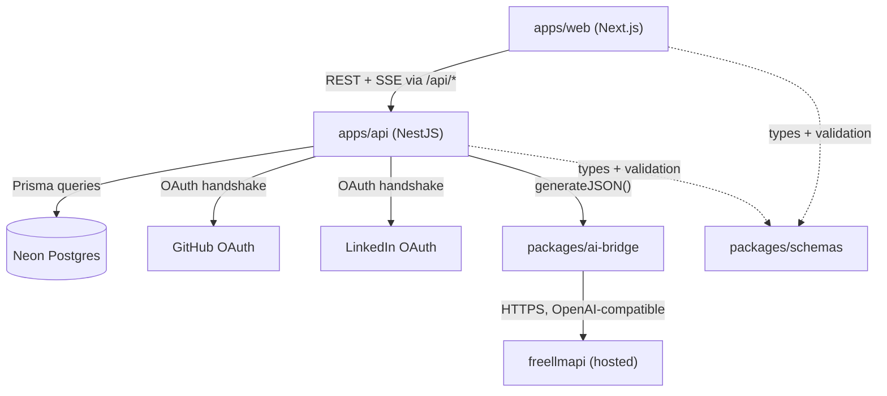
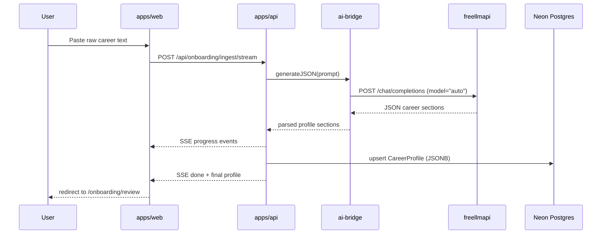

<div align="center">
  <h1>Resumiq <sup><sub>v0.1.0</sub></sup></h1>
  <p>
    <em>Parses raw career history into a structured profile via AI — the foundation for the tailored resume generator ahead.</em>
  </p>
  <br />

  
  
  
  
  

  [**Live app**](https://resume-web-six-black.vercel.app) · [**API**](https://resume-4kci.onrender.com)
</div>

---

Every job application wants a resume tailored to it, and nobody has the patience to rewrite one from scratch each time. The friction isn't writing — it's that your actual career history lives scattered across an old resume, a LinkedIn export, and memory, in no structured form a program can work with.

Resumiq turns that raw text into structure. Paste a career recap — a LinkedIn export, old resume content, freeform notes — and an LLM parses it into a typed career profile: experience, education, projects, skills, each entry validated against a shared schema. That structured profile is the substrate everything else builds on.

The interesting call here is the LLM layer. Instead of wiring this codebase directly to Gemini or Groq and hand-rolling key rotation and fallback logic, the API talks to [freellmapi](https://github.com/tashfeenahmed/freellmapi) — a self-hosted proxy that aggregates ~30 free-tier providers behind one OpenAI-compatible endpoint and does the routing and failover server-side. The app just sends a prompt and gets JSON back; which underlying provider served it is freellmapi's problem, not this repo's.

This is Phase 0–1 of a larger plan (see [Roadmap](#roadmap)): auth and career-profile ingestion are live in production today. Job matching, resume drafting, and the rest are designed but not built.

## Features

**Auth**
- **GitHub + LinkedIn OAuth** — sign in via either provider; sessions are issued and validated by [better-auth](https://better-auth.com) against a Postgres-backed session table.

**Career Profile**
- **AI onboarding ingest** — paste raw career text and freellmapi parses it into structured experience, education, project, and skill entries, streamed back over SSE as it processes.
- **Profile CRUD** — `GET`/`PATCH` the full career profile; `PATCH` merges into existing sections instead of overwriting them.
- **Strength score** — a 0–100 score recomputed on every update, weighted by section completeness (experience and projects weigh heaviest).

**Platform**
- **Env validation at boot** — a Zod schema validates every required environment variable before the Nest app starts listening. A misconfigured deploy fails immediately with a clear message instead of crashing on the first real request.
- **Layered rate limiting** — Nest's `ThrottlerGuard` covers standard routes; better-auth's own limiter separately covers `/api/auth/*`, which is mounted directly on the raw Express instance and bypasses Nest's guard pipeline entirely.
- **Global exception filter** — unhandled errors are logged server-side and never leak a stack trace or internal message to the client.

## How It Works





**Key decisions**

- **freellmapi over direct provider keys**: one hosted, OpenAI-compatible endpoint with server-side routing across ~30 free-tier LLM providers, instead of this codebase owning key rotation and fallback logic across Gemini/Groq/etc directly.
- **`vercel --prod` CLI deploy over Git-auto-deploy**: Vercel's Hobby plan blocks a deploy when the pushing commit's GitHub identity doesn't have contributing access to the linked Vercel account's project — a mismatch this repo hits structurally after an account/repo-ownership change. CLI deploy bypasses git-attribution checks entirely and is the standing deploy method here, not a workaround used once.
- **Real `tsc` build step for workspace packages over raw-`.ts` via `tsconfig` paths**: NestJS's `tsc`-based build infers `rootDir` from every file it type-checks, including anything reached through a `paths` mapping. Pointing `paths` straight at a workspace package's raw `.ts` source pulled that package into the build's rootDir inference, producing nested output (`dist/apps/api/src/main.js` instead of `dist/main.js`) and, at runtime, trying to load raw TypeScript through the npm workspace symlink — which only ever worked under `ts-node`/`nodemon` in dev, never under plain `node` in production. `packages/ai-bridge` and `packages/schemas` now ship real compiled `dist/` output; `turbo.json`'s `dependsOn: ["^build"]` builds them before `apps/api`.
- **JSONB columns for `CareerProfile` over a fully normalized schema**: the AI-parsed career sections have no fixed shape yet at this phase. JSONB keeps the Postgres schema stable while `packages/schemas`' Zod types — not migrations — enforce structure, and can evolve without a migration each time a section's shape changes.
- **One shared Zod schema package over per-app types**: `apps/api` and `apps/web` both need the same `CareerProfile` shape. `packages/schemas` is the single source; both apps import compiled output from it rather than each maintaining a parallel type.

## Tech Stack

| Technology | Role | Why |
|---|---|---|
| Next.js 16 (App Router) | Frontend | — |
| React 19 | UI library | — |
| NestJS | Backend API | Decorator-based DI matches the modular auth/profile/onboarding module boundary |
| better-auth | Auth (GitHub + LinkedIn OAuth) | Framework-agnostic, first-class Prisma adapter, no vendor lock-in |
| Prisma | ORM | Type-safe schema; JSONB columns for the still-evolving career-profile shape |
| PostgreSQL (Neon) | Database | Serverless Postgres, free tier, no infra to manage |
| Zod | Runtime validation + shared types | One schema package (`packages/schemas`) shared between both apps |
| freellmapi | LLM provider | Hosted proxy aggregating ~30 free-tier providers behind one OpenAI-compatible endpoint with server-side routing/failover |
| Turborepo | Monorepo build orchestration | `dependsOn: ["^build"]` builds workspace packages before their dependents |
| Render | API hosting | Free tier |
| Vercel | Web hosting | Free tier; deployed via CLI, see Key Decisions |

## Getting Started

### Prerequisites

- Node.js ≥ 20
- A PostgreSQL database (a free [Neon](https://neon.tech) instance works, or run Postgres locally)
- OAuth apps for [GitHub](https://github.com/settings/developers) and [LinkedIn](https://www.linkedin.com/developers/apps)
- Access to a freellmapi-compatible endpoint — either [self-host freellmapi](https://github.com/tashfeenahmed/freellmapi) or point `FREELLMAPI_BASE_URL` at any other OpenAI-compatible API

### Clone

```bash
git clone https://github.com/Yassinekrn/resume.git
cd resume
```

### Install

```bash
npm install
```

npm workspaces installs `apps/api`, `apps/web`, `packages/ai-bridge`, and `packages/schemas` together from the root.

### Configure

```bash
cp apps/api/.env.example apps/api/.env
cp apps/web/.env.example apps/web/.env.local
# fill in both — see Configuration below
```

### Set up the database

```bash
npx prisma migrate dev --schema apps/api/prisma/schema.prisma
```

### Run (development)

```bash
npm run dev
```

Runs both apps via `turbo dev`. Web is at `http://localhost:3000`, API at `http://localhost:3001`.

### Run (production)

```bash
npm run build
node apps/api/dist/main.js &
npm start --workspace=@resumiq/web
```

### Test

```bash
npm test
```

Runs Jest for `apps/api` and `packages/ai-bridge`, Vitest for `apps/web`.

## Configuration

**`apps/api`**

| Variable | Required | Default | Description |
|---|---|---|---|
| `DATABASE_URL` | Yes | — | PostgreSQL connection string |
| `API_URL` | Yes | — | This service's own public URL |
| `TRUSTED_ORIGINS` | Yes | — | Comma-separated origins allowed by CORS |
| `BETTER_AUTH_SECRET` | Yes | — | Signing secret for auth sessions; better-auth refuses to boot without it |
| `GITHUB_CLIENT_ID` / `GITHUB_CLIENT_SECRET` | Yes | — | GitHub OAuth app credentials |
| `LINKEDIN_CLIENT_ID` / `LINKEDIN_CLIENT_SECRET` | Yes | — | LinkedIn OAuth app credentials |
| `FREELLMAPI_BASE_URL` | No | `https://freellmapi-19vj.onrender.com/v1` | freellmapi endpoint |
| `FREELLMAPI_API_KEY` | Yes* | — | freellmapi key (*required unless `USE_LLM_BRIDGE=true`) |
| `FREELLMAPI_MODEL` | Yes* | `auto` | Model id, or `auto` to let freellmapi route (*same condition) |
| `USE_LLM_BRIDGE` | No | `false` | Switch to the claude-web-bridge fallback provider instead of freellmapi |
| `BRIDGE_URL` / `BRIDGE_PROVIDER` | Yes if bridge | — | Only read when `USE_LLM_BRIDGE=true` |

**`apps/web`**

| Variable | Required | Default | Description |
|---|---|---|---|
| `NEXT_PUBLIC_API_URL` | Yes | — | Bare API origin, no `/api` suffix — the client appends `/api/*` itself |

## API / Usage

`POST /api/auth/*` — better-auth's own routes (sign-in, sign-out, session, OAuth callbacks), mounted directly on the raw Express instance ahead of Nest's request pipeline.

`GET /api/profile` — the authenticated user's career profile.

`PATCH /api/profile` — merges a partial career profile update into the existing one; recomputes the strength score.

`POST /api/onboarding/ingest/stream` — SSE. Streams progress while an LLM parses pasted raw career text into structured profile sections.

## Deployment

API on [Render](https://render.com) (free tier), configured by `render.yaml`:

```
build:  npm install && npx turbo build --filter=@resumiq/api
start:  npx prisma migrate deploy --schema apps/api/prisma/schema.prisma && node apps/api/dist/main.js
```

Web on [Vercel](https://vercel.com) (free tier), deployed via the CLI — not Git-auto-deploy, see Key Decisions above:

```bash
cd apps/web && vercel --prod
```

Database on [Neon](https://neon.tech) (free tier) — no separate provisioning step; just set `DATABASE_URL`.

## Roadmap

| Status | Item |
|---|---|
| ✅ | Phase 0 — Auth (GitHub + LinkedIn OAuth via better-auth) |
| ✅ | Phase 1 — Career profile CRUD + AI onboarding ingest |
| 🔲 | Phase 2 — Job matching & gap analysis against the career profile |
| 🔲 | Phase 3 — Resume generation & LaTeX rendering from the web app itself |
| 🔲 | Phase 4 — Job scraping & application tracking |
| 🔲 | Phase 5 — Mock interviews, analytics, auto-apply |

Full detail in [`ROADMAP.md`](./ROADMAP.md) and [`ROADMAP_v2.md`](./ROADMAP_v2.md).

`cli/` holds the original V1 standalone tool this project grew out of — a local CLI that did the resume-generation half of this pipeline (job description in, tailored LaTeX resume out) against a static JSON career database, using a browser-automation LLM bridge instead of an API. It's not part of the npm workspaces and isn't run by anything in `apps/`; kept for reference while Phase 3 rebuilds that generation step properly inside the web app.

## License

MIT © 2026 Yassine Krichen

---

Built by [Yassine Krichen](https://github.com/Yassinekrn)

## Before You Publish

- [ ] Add a cover image / screenshots under `docs/` — the live app link stands in for a demo section for now, but a couple of screenshots (login, dashboard, onboarding flow) would help anyone skimming this on GitHub.
- [ ] Decide the fate of `data_inventory.json` at the repo root — it's tracked in git and looks like personal career data (the V1 CLI's input file), same category as the `.tex` files already removed this session. Worth the same back-up-then-remove treatment if it's real personal data.
- [ ] LinkedIn OAuth credentials on the live Render deploy are currently placeholder values (`unset`) — LinkedIn sign-in will error in production until real ones are set.
