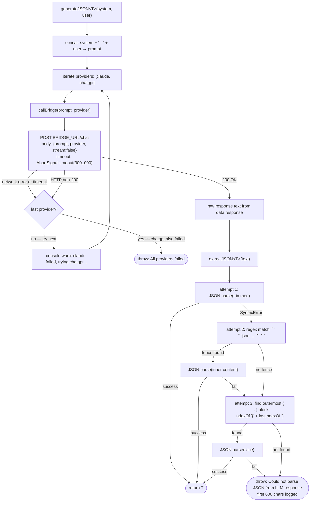
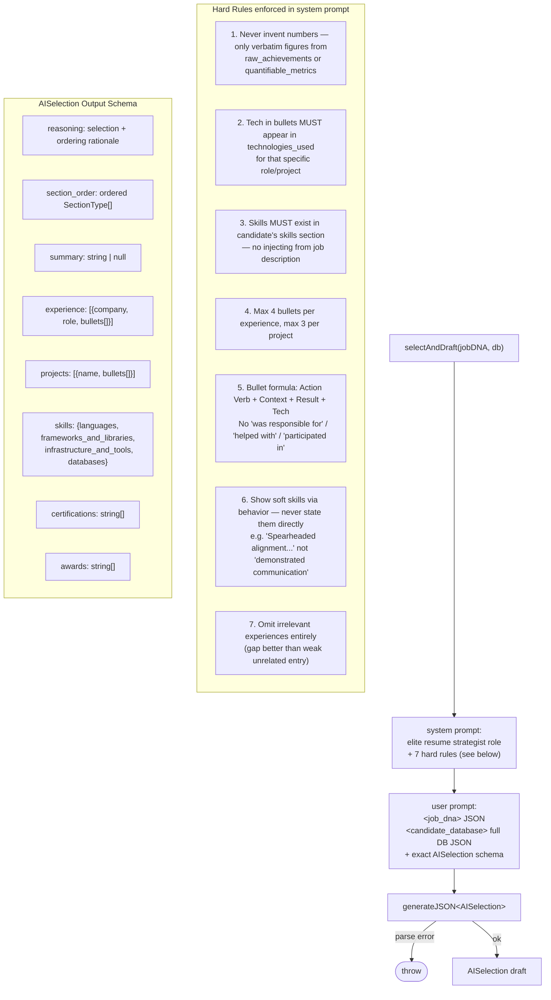
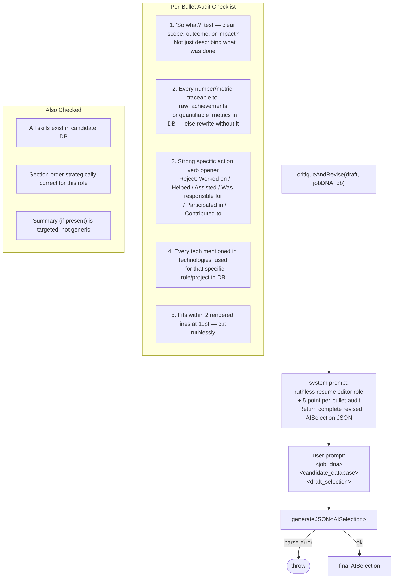
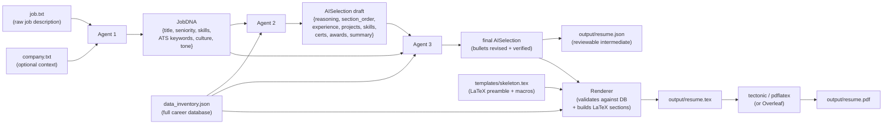

# Pipeline Diagrams — AI Resume Generator

---

## 1. Main CLI Pipeline

Full flow from `npm run generate` to PDF output, including `--render-only` mode and all error paths.

```mermaid
flowchart TD
    START([npm run generate / render]) --> RFLAG{--render-only?}

    RFLAG -->|yes| RO_LOAD[read output/resume.json]
    RO_LOAD --> RO_EXISTS{file exists?}
    RO_EXISTS -->|no| ERR_RO([Error: run npm run generate first])
    RO_EXISTS -->|yes| RENDER_STEP

    RFLAG -->|no| BRIDGE[checkBridge GET /health 5s timeout]
    BRIDGE -->|timeout or non-200| ERR_BRIDGE([Error: bridge not reachable\nprint start instructions])
    BRIDGE -->|200 OK| READ_DB[read data_inventory.json]
    READ_DB --> READ_JD[read input/job.txt required]
    READ_JD --> JD_PLACEHOLDER{starts with placeholder text?}
    JD_PLACEHOLDER -->|yes| ERR_JD([Error: replace placeholder in job.txt])
    JD_PLACEHOLDER -->|no| READ_CO[read input/company.txt optional]
    READ_CO --> CO_CHECK{file exists AND not placeholder?}
    CO_CHECK -->|yes| WITH_CO[companyInfo = file contents]
    CO_CHECK -->|no| NO_CO[companyInfo = empty string]

    WITH_CO --> AGT1
    NO_CO --> AGT1

    AGT1[Agent 1: analyzeJob] --> AGT1_OUT{success?}
    AGT1_OUT -->|fail| ERR_LLM([throw LLM error])
    AGT1_OUT -->|ok| JDNA[JobDNA]
    JDNA --> LOG1[log: title + seniority + ATS keywords]

    LOG1 --> AGT2[Agent 2: selectAndDraft]
    AGT2 --> AGT2_OUT{success?}
    AGT2_OUT -->|fail| ERR_LLM
    AGT2_OUT -->|ok| DRAFT[AISelection draft]
    DRAFT --> LOG2[log: experience count + project count + section order]

    LOG2 --> AGT3[Agent 3: critiqueAndRevise]
    AGT3 --> AGT3_OUT{success?}
    AGT3_OUT -->|fail| ERR_LLM
    AGT3_OUT -->|ok| FINAL[final AISelection]

    FINAL --> SAVE_JSON[write output/resume.json]
    SAVE_JSON --> LOG3[log: review + edit suggestion]
    LOG3 --> RENDER_STEP

    RENDER_STEP[render: build LaTeX from selection + DB] --> RVAL{renderer validation}
    RVAL -->|company name not found in DB| ERR_CO([throw: company not in DB])
    RVAL -->|project name not found in DB| ERR_PR([throw: project not in DB])
    RVAL -->|skeleton missing %%CONTENT%%| ERR_SK([throw: invalid skeleton])
    RVAL -->|cert or award name not in DB| WARN[console.warn + skip entry]
    WARN --> WRITE_TEX
    RVAL -->|all OK| WRITE_TEX[write output/resume.tex]

    WRITE_TEX --> COMPILE[tryCompile]
    COMPILE --> TEC{tectonic in PATH?}
    TEC -->|yes| TEC_RUN[tectonic compile]
    TEC_RUN -->|success| PDF([output/resume.pdf])
    TEC_RUN -->|fail| PDFL
    TEC -->|no| PDFL{pdflatex in PATH?}
    PDFL -->|yes| PDF_RUN[pdflatex -interaction=nonstopmode]
    PDF_RUN -->|success| PDF
    PDF_RUN -->|fail| OVERLEAF
    PDFL -->|no| OVERLEAF([print Overleaf instructions\ntectonic install links])
```



---

## 2. LLM Bridge Client

How `generateJSON<T>` calls the bridge, falls back to ChatGPT, and extracts JSON from unpredictable LLM output.



---

## 3. Agent 1 — Job Analyzer

Extracts structured job requirements (JobDNA) from raw job description text.

```mermaid
flowchart LR
    IN["analyzeJob(jd, companyInfo)"] --> SYS["system prompt:\nsenior technical recruiter\n+ ATS expert role\n+ read between the lines rule\n+ Return ONLY valid JSON"]

    SYS --> USER["user prompt:\n&lt;job_description&gt; block\n&lt;company_info&gt; block\nexact schema definition"]

    USER --> LLM["generateJSON&lt;JobDNA&gt;(system, user)"]
    LLM -->|parse error| ERR(["throw"])
    LLM -->|ok| OUT

    subgraph OUT [JobDNA Output Schema]
        F1["job_title: string"]
        F2["seniority: Junior | Mid | Senior | Lead"]
        F3["mandatory_technical_skills: string[]"]
        F4["mandatory_soft_skills: string[]"]
        F5["nice_to_have_skills: string[]"]
        F6["ats_keywords: 5–10 exact ATS phrases"]
        F7["company_culture_and_values: string[]"]
        F8["primary_responsibilities_summary: 2 sentences max"]
        F9["tone_recommendation: e.g. impact-driven, metric-focused"]
    end
```



---

## 4. Agent 2 — Content Selector & Drafter

Filters career DB against JobDNA, selects relevant content, writes targeted bullets.



---

## 5. Agent 3 — Critique & Revise

Audits every bullet in the draft against a strict checklist and returns a revised selection.



---

## 6. LaTeX Renderer

Builds resume content from AISelection, injects into skeleton, validates against DB, compiles PDF.

```mermaid
flowchart TD
    IN["render(selection, db, skeletonPath)"] --> READ["read skeleton.tex"]
    READ --> CHK_SKEL{contains %%CONTENT%%?}
    CHK_SKEL -->|no| ERR_SK(["throw: skeleton missing %%CONTENT%% placeholder"])
    CHK_SKEL -->|yes| HEADER["renderHeader(db.personal_info)\nname, location, phone, email, links\nURLs strip protocol for display"]

    HEADER --> ORDER["buildContent: iterate section_order\nnote: education FORCED first\nregardless of AI ordering"]

    ORDER --> SEC{section type}

    SEC -->|education| EDU["renderEducation\ninstitution, degree + GPA + honors\ndate range — always included"]

    SEC -->|experience| EXP["for each experience in selection"]
    EXP --> EXP_CHK{company found in DB?}
    EXP_CHK -->|no| ERR_CO(["throw: company not in DB"])
    EXP_CHK -->|yes| EXP_DATES["get startDate + endDate from DB\nrender: company, role, location, dates\nbullets with tex() escaping"]

    SEC -->|projects| PROJ["for each project in selection"]
    PROJ --> PROJ_CHK{project found in DB?}
    PROJ_CHK -->|no| ERR_PR(["throw: project not in DB"])
    PROJ_CHK -->|yes| PROJ_LINK{GitHub link in DB?}
    PROJ_LINK -->|yes| PROJ_HREF["name rendered as hyperlink"]
    PROJ_LINK -->|no| PROJ_PLAIN["name rendered as plain text"]
    PROJ_HREF --> PROJ_BODY["tech stack inline + bullets"]
    PROJ_PLAIN --> PROJ_BODY

    SEC -->|skills| SKILLS["languages / frameworks / tools / databases\njoined with comma separators"]

    SEC -->|certifications| CERT["for each cert name in selection"]
    CERT --> CERT_CHK{name found in DB?}
    CERT_CHK -->|no| CERT_WARN["console.warn: AI hallucinated cert name — skip"]
    CERT_CHK -->|yes| CERT_RENDER["render: name, issuer, date"]

    SEC -->|awards| AWD["for each award in selection"]
    AWD --> AWD_CHK{title found in DB?}
    AWD_CHK -->|no| AWD_WARN["console.warn: AI hallucinated award title — skip"]
    AWD_CHK -->|yes| AWD_RENDER["render: title, issuer, date"]

    SEC -->|summary| SUM{"summary string\nin selection?"}
    SUM -->|yes| SUM_RENDER["render summary paragraph"]
    SUM -->|no| SUM_SKIP["skip section entirely"]

    EDU --> INJECT
    EXP_DATES --> INJECT
    PROJ_BODY --> INJECT
    SKILLS --> INJECT
    CERT_RENDER --> INJECT
    CERT_WARN --> INJECT
    AWD_RENDER --> INJECT
    AWD_WARN --> INJECT
    SUM_RENDER --> INJECT
    SUM_SKIP --> INJECT

    INJECT["replace %%CONTENT%% in skeleton\nwith assembled sections"] --> OUT["resume.tex string"]

    subgraph TEX_ESCAPE [tex() escaping — applied to all user content]
        E1["& → \\&"]
        E2["% → \\%"]
        E3["$ → \\$"]
        E4["# → \\#"]
        E5["_ → \\_"]
        E6["{ } → \\{ \\}"]
        E7["~ → \\textasciitilde{}"]
        E8["^ → \\textasciicircum{}"]
        E9["\\ → \\textbackslash{}"]
    end
```

---

## 7. Data Flow Summary

End-to-end data transformation across the pipeline.


