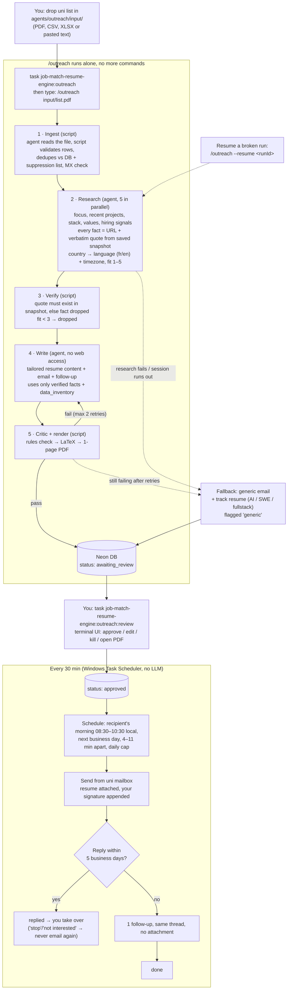

# Outreach agent — spec

Cold-outreach pipeline for part-time jobs and internships. You hand it a list of companies, it
researches each one, tailors a resume and an email per company, you approve the batch in a
terminal UI, and a scheduler sends 20–30 a day with one follow-up.

Status: spec agreed 2026-10-06. Phase 1 not built yet.

---

## Read this next time (the diagram)



**Your hands-on time:** drop list → `/outreach <file>` → later `outreach:review` → approve. Everything
else is automatic. Check progress with `task job-match-resume-engine:outreach:status`.

---

## 1. Design principles

1. **The agent only judges. Small programs do everything else.** Claude Code (Opus) does research,
   fit scoring, choosing what to emphasize and writing. Deterministic TypeScript scripts do parsing
   checks, dedupe, email checks, quote verification, the critic, LaTeX render, DB writes,
   scheduling, sending, reply detection and the review UI. Scripts are cheap, testable and never
   hallucinate; the agent's tokens go only where judgment is needed.
2. **State lives in the DB, not in the agent's head.** Every company carries a stage status, so any
   run can stop (session limit, crash, PC off) and resume exactly where it left off.
3. **One wrong fact ends the conversation.** Every claim about a company carries a source URL and a
   verbatim quote; code checks the quote exists in a saved raw snapshot of that page. The writer
   agent has no web access and only sees verified facts.
4. **Every LLM output is validated with zod** before it touches the DB.
5. **Always produce something sendable.** Each stage has a fallback (section 6), so a bad page, a
   failed critic or a dying session degrades to a generic-but-decent email, never to nothing.

## 2. Inputs

- **Uni list (main input).** Comes as a PDF. The agent reads the PDF directly (Claude Code reads
  PDFs natively, no converter script needed) and writes `normalized.json`; the ingest script
  validates every row with zod. CSV, XLSX and pasted text are accepted the same way.
  Row shape: `company` (required), `email` (required), optional `name`, `role`, `website`, `notes`.
- **Sourcing (phase 3).** `/outreach --source "remote-friendly AI startups in France, 5–50 people"`.
  The agent finds companies and a verified contact email, then they go through the same pipeline.
- **Candidate data.** `data_inventory.json` is the single source of truth for the resume and for
  any fact about you in the email.

## 3. Recipient, language, timezone

- **To:** exactly the email given in the list for that company. No CC, no swapping to another
  person. Research may still find the person's name for the greeting when the list email is a
  named person.
- **Language:** French for France, Belgium (FR), Switzerland (Romandie), Québec, Luxembourg, Monaco.
  English everywhere else. No German.
- **Timezone:** IANA zone of the company's HQ city (from research, fallback by country; US fallback
  America/New_York). Used for send time and for the availability line.
- **Resume language:** English for every market.

## 4. Resume tailoring (rewrite, not copy)

Per company, the writer agent:

- picks the 2–4 most relevant projects and experiences, and their order;
- **rewrites the bullets** to match the company's profile: their keywords, their values, their stack,
  emphasizing the part of the work they care about (e.g. the same project framed around reliability
  for an infra company, around shipping speed for an early startup);
- writes a company-specific summary;
- picks the skills subset to show.

Guardrails (existing resume rules in `packages/ai-bridge/src/agents.ts` AGENT2_SYSTEM, enforced by
code, not just by prompt):

- each rewritten bullet cites the `data_inventory` entry it comes from;
- every number in a bullet must exist in that entry's achievements/metrics;
- every technology in a bullet must be in that entry's `technologies_used`;
- company keywords are only used if they are real skills of yours; their stack is never copied in;
- skills shown ⊆ your skills; 1 page; max 3 bullets per project, 4 per experience.

Fallback track resumes: three pre-built, polished resumes (`ai`, `swe`, `fullstack`) compiled once
and stored. Used whenever tailoring fails (section 6).

## 5. Email

- **Subject:** ≤ 60 chars, mentions something specific to the company.
- **Body:** 50–120 words (FR 55–130). One real hook from a verified fact (recent launch, product, repo,
  stack choice), one proof point from your work that maps to it, one ask.
- **The ask:** part-time remote, ~20 h/week (see section 8), start date, and timezone overlap.
- **Location (Tunisia):** not the hook and not hidden. The body talks about overlap, not geography:
  - Europe: "UTC+1, same working hours as Paris/Berlin".
  - US: "available 12:00–16:00 ET" (that is 18:00–22:00 in Tunis).
  The resume header shows the location anyway, so nobody feels misled on a call. Leading with skills
  plus overlap is the strongest pitch; leading with location invites a filter before they read.
- **Signature:** your professional signature from the uni mailbox. API sends do NOT add the
  signature automatically, so the sender fetches it from the mailbox settings and appends it
  (the message is sent as text + HTML).
- **Follow-up:** exactly one, 5 business days later, same thread, no attachment, 25–70 words, adds
  one new angle instead of "just following up". Most replies come from the first email plus the
  first follow-up; more nudges mostly add annoyance for job applications.
- **Opt-out:** no opt-out line in the body and no bulk-mail headers (they make a personal email look
  like marketing and push it to the Promotions tab). Instead: if anyone replies "stop" or "not
  interested", the address goes on a permanent suppression list.
- **Attachment:** the tailored PDF (~40 KB), named `Firstname-Lastname-Resume.pdf`.

### Critic rules (deterministic, all must pass)

- word bands above; subject length, no `!`, no all-caps words;
- banned phrases EN: "reaching out", "leverage", "I hope this finds you", "I am writing to",
  "passionate", "synergy", "touch base", "esteemed", "cutting-edge"; FR: "je me permets de vous
  contacter", "n'hésitez pas", "passionné", "j'espère que vous allez bien", "dynamique";
  follow-up: "just following up", "circling back", "bumping";
- exactly one call to action, at most one question mark;
- the hook phrase appears verbatim in the body and points to a verified claim;
- hours/week, start date and overlap line are present;
- every number appears in data_inventory, the cited quote or the config;
- only projects that exist in data_inventory; only your own links;
- no placeholders, no markdown, no em dashes; company name present;
- language check: the body really is in the expected language.

## 6. Fallback ladder

| Failure | What happens |
|---|---|
| Unreadable list row | Agent repairs it; if still invalid, listed in the summary, skipped |
| Research finds no verifiable fact | Generic email: company name + their public one-liner + track resume, flagged `generic` |
| Writer fails critic twice | Generic email + track resume, flagged `generic` |
| LaTeX render fails / not 1 page | Track resume for the company's best-fit track |
| Session limit / crash mid-run | Nothing lost; `/outreach --resume <runId>` continues from each company's last finished stage |
| No time for a full run at all | `/outreach <file> --generic` skips research and tailoring: generic email + track resume for every row |
| Send fails | Marked failed, retried next tick; a send whose outcome is unknown is never auto-retried (no double sends) |
| Bounce | Marked bounced, no follow-up |

Generic drafts appear in the review UI with a label, so you can decide per row.

## 7. Sending

- **Mailbox:** uni email `@insat.ucar.tn`, which is Google Workspace (MX = smtp.google.com), so
  the Gmail API is the only sender. If the uni blocks third-party app access, switch the config to
  the personal `@gmail.com` account: same code, different OAuth login.
- **Signature, guaranteed:** the signature is appended by code in the one function that builds every
  outgoing message (initial and follow-up); the agent never writes it. It is fetched from the
  mailbox's own signature setting and cached in `agents/outreach/signature.html`. The sender
  refuses to send if the signature is missing or empty, and a test asserts every built message
  contains it.
- **Cap:** 20/day in week 1, then 30/day if no bounces. Follow-ups count toward the cap.
- **Timing:** recipient's next business day, 08:30–10:30 local time, 4–11 minutes between any two
  sends. A slot missed by > 2 h moves to the next window instead of landing at night.
- **Runs:** `outreach:tick` every 30 minutes via Windows Task Scheduler. The PC must be on.
- **Replies:** each tick checks every sent thread. A reply cancels the follow-up and marks the
  company `replied`; a bounce marks `bounced`.
- **No double sends:** one DB row per (draft, initial|follow_up) with a unique constraint; a row is
  marked `sending` before the API call.

## 8. Your availability (from the S1 2026-27 timetable, GL4/1, valid 1 Sep – 12 Dec 2026)

Classes Mon–Sat mornings plus most of Mon/Thu. Guaranteed free:

- weekday evenings after 17:15 (Tunis, UTC+1, no DST);
- Tuesday 13:00–15:45, Wednesday from 13:00, Friday 11:15–14:00 and from 15:30;
- Saturday afternoon, all of Sunday.

That is roughly 20 h/week. Pitch: **~20 h/week, starting now; more after 12 Dec (winter break)**.
Overlap line: Europe afternoons/evenings, US East 12:00–16:00 ET. Stored in
`agents/outreach/outreach.config.json` so the next semester's timetable only changes config.

**Summer 2027: full-time internship, mandatory for the degree.** The ask in every email is one
sentence covering both: part-time remote now, or the summer 2027 internship. Still one call to
action (a short call). Dates/duration of the mandatory internship go in config.

## 9. Review UI (terminal)

`task job-match-resume-engine:outreach:review`, built with **Ink** (React for the terminal, same
library Claude Code uses), styled like Charm apps (rounded borders, muted palette, key hints bar).
Not Charm/Bubble Tea itself: that is Go, and the review screen must re-run the TypeScript critic
on edits and share the zod schemas, so staying in TypeScript avoids a second language and
duplicated rules.

- pipeline strip: counts per status, today's sent / cap;
- list: company, country, language, fit, `generic` flag, subject;
- detail pane: email, follow-up, hook + its source URL;
- keys: `a` approve, `A` approve all visible, `e` edit (opens your editor, critic re-runs on save),
  `k` kill, `o` open PDF, `/` filter.

No web page, no API module, no auth needed for this feature.

## 10. Architecture

```
agents/outreach/                  Claude Code workspace (task job-match-resume-engine:outreach)
  CLAUDE.md                       pipeline contract + hard rules
  outreach.config.json            hours, start date, availability, cap, sender, tracks
  .claude/commands/outreach.md    the single command (+ --resume, --generic, --source)
  .claude/agents/                 outreach-researcher (web), outreach-writer (no web), outreach-sourcer
  .claude/settings.json           researcher's shell limited to the snapshot script (prompt-injection guard)
  prompts/                        research, tailor-resume, write-email, source
  input/ runs/ logs/              gitignored
packages/outreach/                pure logic + tests: normalize, dedupe, email-check, snapshot-text,
                                  quote-verifier, critic, bullet-guard, build-selection, locale,
                                  send-scheduler, mime, sender adapters
packages/schemas/src/outreach.ts  zod: input rows, dossier, tailoring, draft, config
apps/api/scripts/outreach-*.ts    CLIs: ingest, snapshot, process, summary, auth, tick, review, status
apps/api/prisma                   migration phase6_outreach (+ hand-written down.sql)
```

DB tables: `OutreachCompany` (status per stage, unique per user+domain), `OutreachContact`,
`OutreachDossier`, `OutreachDraft` (versioned, `generic` flag), `OutreachSend` (unique per
draft+kind), `OutreachEvent` (audit), `OutreachSuppression`.

## 11. Phases

1. **MVP:** list in → research → tailored drafts + PDFs → terminal review → manual `outreach:tick`
   (first test sends to your own two addresses). Includes track resumes, `--resume` and `--generic`.
2. **Autonomy:** reply/bounce/suppression sync, follow-ups, Task Scheduler install.
3. **Sourcing:** `--source "<criteria>"`, contact discovery (Hunter if a key is set).
4. **Hardening:** blind verifier agent re-checks every sentence against sources; headless
   `claude -p` batch mode for very large lists; delete data on dead leads after 180 days.

## 12. Open items

- Whether the uni Workspace allows third-party app access (found out at first OAuth login;
  fallback is the personal Gmail).
- Summer 2027 internship: exact dates / minimum duration required by the program.
- Germany and other strict markets: cold job-application emails are generally accepted, the
  suppression list is the safeguard. Not legal advice.
