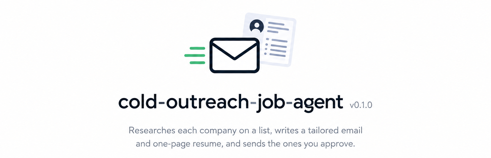
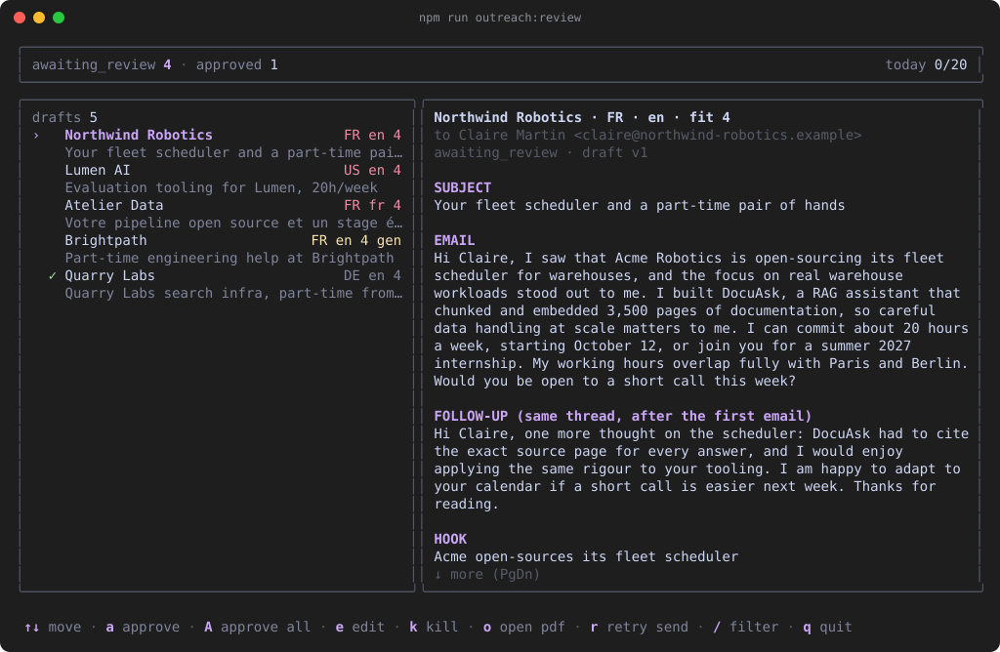
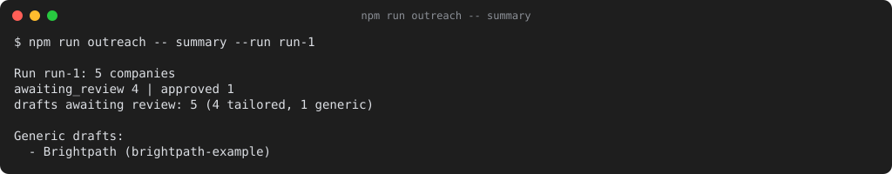
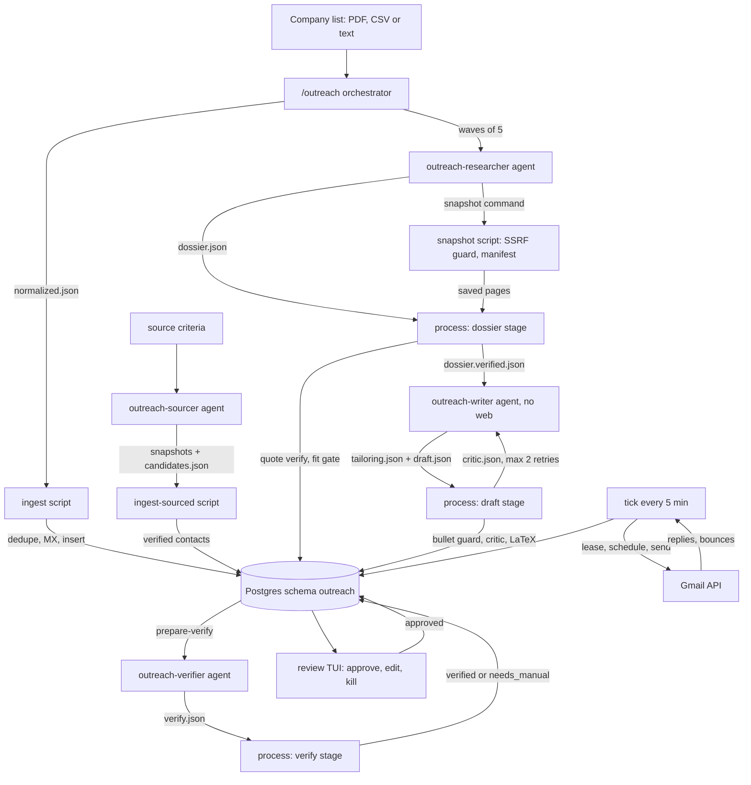
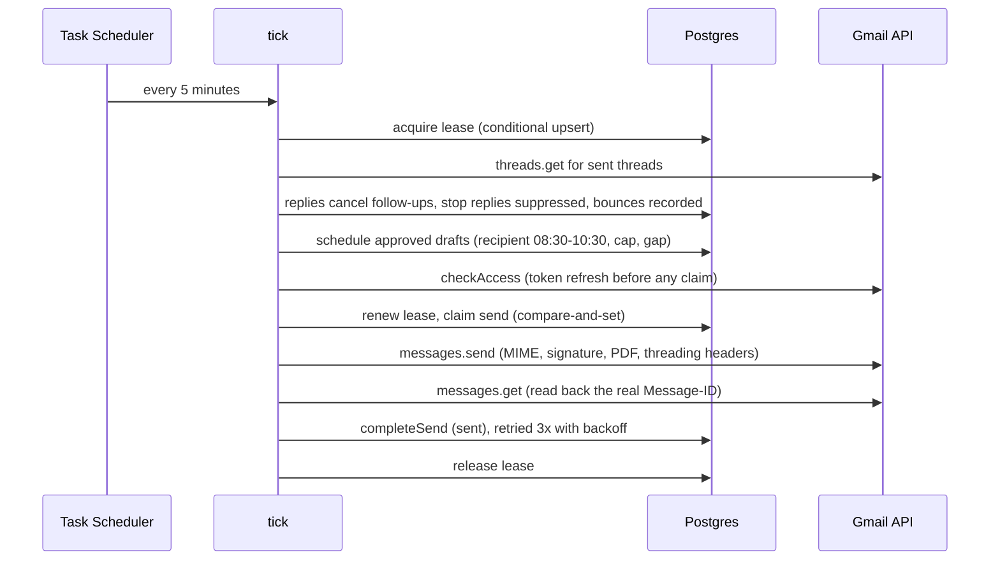

<div align="center">
  
  <h1>
    cold-outreach-job-agent <sup><sub>v0.1.0</sub></sup>
  </h1>
  <p>
    <em>Researches each company on a list, writes a tailored email and one-page resume, and sends the ones you approve.</em>
  </p>


</div>

Part-time roles and internships are rarely posted. They get created when someone at a 5 to 50 person company reads a short, specific email and thinks "we could use that person 20 hours a week". Writing that email well takes 20 minutes of research per company. Writing it badly at scale gets you ignored, or flagged as spam.

This project splits the work. Claude Code agents do the judgment: research each company, score the fit, choose what to emphasise on the resume, write the email. Plain TypeScript scripts do everything else: parse the list, save web pages as evidence, verify every quote, check every draft against a rule set, render the LaTeX resume, store state in Postgres, and send through the Gmail API on a schedule. You stay in the loop once per batch, in a terminal review screen.

The non-obvious part is how little the agents are trusted. Every fact about a company must be a verbatim quote from a page the snapshot script saved, and code checks the quote is really there. The writer agent has no web access and only sees facts that passed. Rewritten resume bullets cannot introduce a number or technology absent from the source entry. A second, blind agent re-reads each finished email sentence by sentence against the sources. One wrong fact ends a cold email's chances, so the system is built to fail closed.

## Features

### Pipeline

- **One command** — `/outreach <list>` runs ingest, research, verification, tailoring, rendering and blind verification without further prompts, then stops at the review gate.
- **Any list format** — the orchestrator reads PDF, CSV, JSON or pasted text; the ingest script validates every row with zod, dedupes by domain against the database and the suppression list, and checks MX records.
- **Company sourcing** — `/outreach --source "<criteria>"` finds companies from a description; a contact address is accepted only if it is quoted on a saved page, returned by Hunter, or guessed on a domain that accepts mail (flagged low confidence).
- **Resumable runs** — every company carries its own stage in the database, so `/outreach --resume <runId>` continues after a crash or a session limit from each company's last finished step.
- **Fallback ladder** — failed research or a draft that fails the critic twice degrades to a generic email plus one of three pre-built track resumes (ai, swe, fullstack), labelled `generic` in review; `--generic` skips research for a whole list.

### Fact control

- **Quote verification** — each claim stores a URL, a snapshot id and a 20 to 300 character quote; the verifier normalises Unicode and whitespace, then requires an exact substring of the saved page fetched from that same URL.
- **Bullet guard** — rewritten resume bullets and the summary may only contain numbers from the cited entry's achievements and technologies from its `technologies_used`, with an alias table (Postgres/PostgreSQL, K8s/Kubernetes) and a list of about 80 common technologies to catch a copied company stack.
- **Email critic** — word bands per language, banned phrases in English and French, exactly one call to action, a hook phrase that appears verbatim and rests on a verified claim, the availability lines, a number allowlist, a language check on body and follow-up separately.
- **One-page budget** — `tailoring_limits` in the config caps entries, bullets per entry and skills per category. A tailoring over the caps is rejected, and one that still renders to two pages goes back to the writer with a measured instruction ("remove at least 3 bullets or one whole entry") instead of silently becoming a track resume.
- **Blind verifier** — a Haiku agent sees only the email sentences and the verified sources, rebuilt from the database so an agent cannot tamper with its input; any unsupported factual sentence sends the company to `needs_manual`.

### Cost and learning

- **Cost per company and per run** — a `SubagentStop`/`Stop` hook reads each agent's transcript, sums its token usage per model and appends it to `runs/<run>/usage.jsonl`. `cost --run ID` prices it from the `pricing` table in the config and prints a table per company (agent by agent), the orchestrator overhead, the run total and the average per company with and without overhead. On a Claude subscription this is the API-equivalent cost, a measure of quota use, not a bill.
- **Run budget** — set `run_budget_usd` and the orchestrator stops starting research and write waves once the run passes it; the remaining companies take the generic fallback, and the final report says so.
- **Self-learning playbooks** — `playbooks/<agent>.md` holds short hints from earlier runs (blocked sites, useful page patterns, schema mistakes). Agents read their playbook first and add an entry with `learn` when they find a workaround. Because a hostile page could try to plant a "learning", every entry passes a validator first: 15 to 300 characters on one line, no backticks, command substitution, program names, URLs with a path, email addresses or override phrasing; near-duplicates only bump a counter, and a playbook holds at most 40 entries. Entries are hints that never override `CLAUDE.md`; the owner lists and prunes them with `playbook`.

### Sending

- **Terminal review** — an Ink screen with approve, approve-all (skips unverified drafts and low-confidence contacts), edit in your editor with the critic re-run on save, kill, open PDF, retry a failed send, and a filter.
- **Recipient-local scheduling** — sends land on the recipient's next business day between 08:30 and 10:30 local time, 4 to 11 minutes apart measured from the last real send, under a daily cap that ramps from 20 to 30.
- **Threaded follow-up** — one follow-up five business days later in the same Gmail thread; a reply cancels it, a "stop" reply in English or French adds the address to a permanent suppression list, a bounce is recorded.
- **Preview before anything is sent** — `preview --run ID` writes the exact first email and follow-up of every draft as `.eml` files under `storage/<run>/<slug>/` (no Gmail needed, nothing changes in the database). Without a cached signature the preview carries a visibly marked placeholder; the real builder still refuses to send unsigned.
- **Test send to yourself** — `test-send --run ID --to you@example.com` sends the real message, attachment included, through Gmail to your address only, with `[TEST → real recipient]` in the subject. It touches no draft, company or send status and refuses your own contact's address.
- **Mandatory signature** — the MIME builder appends the signature fetched from your Gmail settings to every message and refuses to build one without it.
- **No double sends** — one send row per draft and kind under a unique constraint, a compare-and-set claim before the API call, and an `unknown` state that is never retried automatically.

### Agent safety

- **Bash guard hook** — a PreToolUse hook rejects every shell command that is not an allowlisted `npm run outreach -- <subcommand>`, and blocks chaining, redirects, substitutions and paths outside the run folder.
- **SSRF-guarded snapshots** — the snapshot fetcher classifies every resolved address by bytes (including IPv4-mapped and NAT64 IPv6), pins the connection to the checked IP through an undici dispatcher, and re-checks every redirect hop.
- **Owner-only commands** — `review`, `auth`, `signature`, `tick`, `test-send`, `playbook` and `prune` are denied to agents by both the hook and the permission rules. `learn` is allowed only in one exact shape, with a restricted character set, and its content is validated again by the CLI.
- **Never blocking** — the usage hook always exits 0 and logs its own problems to `logs/hooks.log`, so cost bookkeeping can never stop a run.

## Demo


_The review screen after a run: pipeline counts on top, one row per company with fit, language and flags, the email and its source quote in the detail pane._


_The end-of-run summary: how many companies were drafted, dropped on fit, held for a decision, or fell back to a generic email._

## How It Works





### Key Decisions

- **Agents judge, scripts verify**: deterministic TypeScript for every check and write over letting the model validate its own output, because a script cannot hallucinate, costs no tokens, and has over 1,100 unit tests behind it. The agents' context stays small too: each returns one line, and the orchestrator reads script JSON, never pages or drafts.
- **Quotes against saved snapshots over trusting a fetch tool**: model-facing fetch tools return processed text, so a quote cannot be checked against them. The snapshot script saves the raw page text with its URL in a manifest, and the verifier only resolves ids listed there.
- **Writer without web access**: a second agent that sees only `dossier.verified.json` over one agent that researches and writes, because the writer then has no way to introduce a fact that skipped verification.
- **Lease row over a long advisory-lock transaction**: a 6-minute lease renewed before each send, with a 5-minute trigger, over holding a Postgres advisory lock through a 30-minute tick, because a pooled serverless connection (Neon through PgBouncer) can drop an idle transaction and silently release the lock.
- **Unknown sends are never retried**: a network cut after Gmail accepted the message is indistinguishable from a failure, so the row is parked and surfaced for a manual check of the Sent folder rather than risking a duplicate cold email.

## Tech Stack

| Technology | Role | Why |
| --- | --- | --- |
| Claude Code | Orchestrator and research, writing, sourcing, verifier agents | Subagents with per-agent tool lists, a PreToolUse hook and permission rules give a real sandbox around untrusted web content |
| TypeScript, Node 20 | CLI, pipeline services, sender | — |
| zod | Validation of every agent file, config and env | Agent output is untrusted input |
| Prisma 5 + Postgres | State per company, drafts, sends, events, suppression | A dedicated `outreach` schema keeps its tables and migrations apart from anything else in the database |
| tectonic | LaTeX to PDF | Single binary, fetches packages on demand, no TeX distribution to install |
| Ink + React | Terminal review UI | Shares the TypeScript critic and schemas, so an edit is re-checked by the same code that checked the draft |
| Gmail API (fetch) + google-auth-library | Send, read threads, fetch signature | Desktop OAuth with PKCE; no `googleapis` package for three REST calls |
| undici | Pinned-DNS fetch for snapshots | Lets the SSRF check and the connection use the same resolved address |
| luxon | Recipient time zones, business days | DST-correct scheduling across Europe and the Americas |
| Jest | 1,100+ unit tests | No database, network or LaTeX needed to run them |

## Getting Started

### Prerequisites

- Node.js ≥ 20
- [Claude Code](https://claude.com/claude-code)
- A Postgres database (a free Neon project works)
- [tectonic](https://tectonic-typesetting.github.io/) on `PATH`, or its path in `TECTONIC_PATH`
- A Google Cloud project with the Gmail API enabled and an OAuth client of type "Desktop app" (only needed to send; the step-by-step guide is [docs/GMAIL-SETUP.md](docs/GMAIL-SETUP.md))
- Windows for the bundled scheduler scripts; on macOS or Linux, run `npm run outreach:tick` from cron every 5 minutes

### Clone

```bash
git clone https://github.com/yassine-krichen/cold-outreach-job-agent.git
cd cold-outreach-job-agent
```

### Install

```bash
npm install   # also generates the Prisma client
```

### Configure

```bash
cp .env.example .env
cp outreach.config.example.json outreach.config.json
```

1. Set `OUTREACH_DATABASE_URL` in `.env`. It must end with `?schema=outreach` (or another non-public schema name).
2. Write your candidate data as JSON in the shape of `examples/data-inventory.example.json`, keep it outside the repo, and point `data_inventory_path` at it.
3. Edit hours per week, start date, the availability lines per language, `sender_email`, the daily caps and the three track rules in `outreach.config.json`. The config is validated at startup and the CLI refuses to run on an invalid one.

### Create the database objects

```bash
npm run db:deploy   # applies prisma/migrations/0001_init; roll back with prisma/migrations/0001_init/down.sql
```

### Build the fallback resumes

```bash
npm run outreach -- track-resumes
```

### Run a batch

```bash
claude
# then, inside Claude Code:
/outreach input/companies.pdf
```

Other forms: `/outreach --resume RUN_ID`, `/outreach input/companies.csv --generic`, `/outreach --source "remote-friendly AI startups in France, 5-50 people" --limit 20`.

After the run, `npm run outreach -- cost --run RUN_ID` shows what it used and `npm run outreach -- preview --run RUN_ID` writes the emails as `.eml` files you can open in a mail client.

### Review and send

Set up Gmail once by following [docs/GMAIL-SETUP.md](docs/GMAIL-SETUP.md), then:

```bash
npm run outreach:review      # a approve, A approve all, e edit, k kill, o open PDF, r retry, / filter
npm run outreach -- auth       # once: browser sign-in, token saved outside the repo
npm run outreach -- signature  # once, and again after changing your Gmail signature
npm run outreach -- preview --run RUN_ID                       # the exact emails as .eml files, no Gmail needed
npm run outreach -- test-send --run RUN_ID --to you@example.com  # the real first email, to your own address only
npm run outreach:tick        # sends what is due, for real
powershell -NoProfile -ExecutionPolicy Bypass -File scripts/install-schedule.ps1   # Windows: tick every 5 minutes
```

`scripts/uninstall-schedule.ps1` removes the scheduled task. The task runs only while you are signed in and the machine is on; a missed run starts when it is back.

### Test

```bash
npm test             # unit tests
npm run type-check
npm run build        # compile to dist/
```

## Configuration

| Variable | Required | Default | Description |
| --- | --- | --- | --- |
| `OUTREACH_DATABASE_URL` | Yes | — | Postgres connection string with a non-public `schema=` parameter |
| `TECTONIC_PATH` | No | `tectonic` on `PATH` | Path to the tectonic binary |
| `OUTREACH_CONFIG_PATH` | No | `outreach.config.json` | Config file, relative to the project folder |
| `GMAIL_CLIENT_ID` | To send | — | OAuth client id (Desktop app) |
| `GMAIL_CLIENT_SECRET` | To send | — | OAuth client secret |
| `GMAIL_TOKEN_PATH` | No | `%USERPROFILE%\.config\cold-outreach\gmail-token.json` | Refresh token location; must be outside the repo |
| `HUNTER_API_KEY` | No | — | Enables `hunter <domain>` contact lookups during sourcing |

`outreach.config.json` holds everything else: `data_inventory_path`, availability lines in English and French, `summer_internship`, `daily_cap_week1`, `daily_cap`, send window and gaps, `follow_up_business_days`, `sender_email`, `sender_name`, `draft_retry_limit`, `tailoring_limits` (the one-page budget of a tailored resume), the three track definitions, and for cost tracking `pricing` (USD per million tokens per model id prefix, with `pricing_source` naming where the prices come from) and the optional `run_budget_usd`.

## Usage

`npm run outreach -- <command>`:

`ingest <file> [--run ID]` — validates rows, dedupes against the database and suppression list, checks MX, inserts companies.

`snapshot <url> <dir>` — saves a page as evidence into a run's `snapshots/` folder and its manifest. The only way an agent reads the web.

`process --run ID --stage dossier|draft|verify` — verifies quotes and applies the fit gate; runs the bullet guard and critic and renders the PDF; applies the blind verifier's verdicts.

`generic --run ID` — writes a generic email and attaches a track resume for every unfinished company in the run.

`status` / `summary --run ID` — pipeline counts per run, and the end-of-run report.

`cost --run ID [--json]` / `cost --all` — API-equivalent cost of a run (or of every run): per company with an agent breakdown, orchestrator overhead, run total, average per company with and without overhead, and whether the run is over `run_budget_usd`.

`preview --run ID [--slug S]` — writes `initial.eml` and `follow-up.eml` for every draft awaiting review or approved into `storage/<run>/<slug>/`.

`test-send --run ID --to ADDRESS [--slug S] [--limit N]` — owner only. Sends the real first email of N drafts (default 1) to your address, subject-marked `[TEST → recipient]`; changes no status and records a `test_send` event.

`learn --agent NAME --situation "..." --fix "..."` / `playbook --agent NAME [--remove N]` — add a validated hint to an agent's playbook (what agents run), and list or prune a playbook (owner only).

`prune [--days 180] [--dry-run]` — erases contacts, dossiers, draft text, PDFs and run folders of dead leads older than N days (at least 30), keeping a domain tombstone so the company is never contacted again.

The agents' file contract (dossier, tailoring, draft, candidates, verdicts) is in [CLAUDE.md](CLAUDE.md). The full design is in [docs/SPEC.md](docs/SPEC.md).

## Roadmap

| Status | Item |
| --- | --- |
| ✅ | List ingest, research, quote verification, tailored resume and email, critic |
| ✅ | Fallback ladder: track resumes, generic emails, resumable runs |
| ✅ | Terminal review, Gmail sending, follow-ups, reply, bounce and opt-out sync |
| ✅ | Company sourcing with Hunter fallback, blind verifier, 180-day prune |
| 🔲 | Headless batch mode (`claude -p` workers) — for lists large enough to fill the orchestrator's context |
| 🔲 | Localised resume headings for French-language markets — resumes are English-only today |
| 🔲 | Reply-rate stats per track and language — the events table already holds the data |

## License

**Source-available, not open source.** cold-outreach-job-agent is published under the
[PolyForm Strict License 1.0.0](LICENSE): you may read, run, and learn from the code
for personal, research, or evaluation use.

You may **not** use it commercially, redistribute it, rebrand it, or publish modified
versions without written permission. Copyright (c) 2026 Yassine Krichen. All rights
not granted by the license are reserved.

For commercial licensing or collaboration: krichenyassine22@gmail.com

Built by [Yassine Krichen](https://github.com/yassine-krichen) · Tunis, 2026

