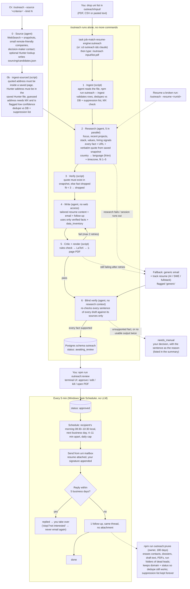

# Outreach agent — spec

Cold-outreach pipeline for part-time jobs and internships. You hand it a list of companies, it
researches each one, tailors a resume and an email per company, you approve the batch in a
terminal UI, and a scheduler sends 20–30 a day with one follow-up.

Status: spec agreed 2026-10-06. Phase 1A (pure logic), the Phase 1B core (DB, CLI, agent workspace) and the Phase 1C/2
code (review UI, Gmail auth and signature, tick with reply/bounce sync and follow-ups, Task Scheduler scripts) are built
and unit-tested against fakes. Phase 3 (sourcing, optional Hunter) and Phase 4 (blind verifier, prune) are built and
unit-tested too; headless batch mode is not built (section 11). Not yet exercised against a real mailbox, the live web or
Hunter: run `auth`, `signature` and a test `tick` to your own addresses first, and try `/outreach --source` with a small
`--limit` before a big one.

This folder is self-contained: it is published on its own (`git subtree push --prefix=outreach`) and imports
nothing from the rest of the repository. Commands below are run inside `outreach/` as
`npm run outreach -- <command>`; from the monorepo root the same things are `task job-match-resume-engine:outreach`
(opens Claude Code here), `...:outreach:status` and `...:outreach:track-resumes`.

---

## Read this next time (the diagram)



**Your hands-on time:** drop list → `/outreach <file>` → later `outreach:review` → approve. Everything
else is automatic. Check progress with `npm run outreach -- status` (monorepo: `task job-match-resume-engine:outreach:status`).

---

## 1. Design principles

1. **The agent only judges. Small programs do everything else.** Claude Code (Opus) does research,
   fit scoring, choosing what to emphasize and writing. Deterministic TypeScript scripts do parsing
   checks, dedupe, email checks, quote verification, the critic, LaTeX render, DB writes,
   scheduling, sending, reply detection and the review UI. Scripts are cheap, testable and never
   hallucinate; the agent's tokens go only where judgment is needed.
2. **State lives in the DB, not in the agent's head.** Every company carries a stage status, so any
   run can stop (session limit, crash, PC off) and resume exactly where it left off.
3. **One wrong fact ends the conversation.** Every claim about a company carries a source URL and a
   verbatim quote; code checks the quote exists in a saved raw snapshot of that page. The writer
   agent has no web access and only sees verified facts.
4. **Every LLM output is validated with zod** before it touches the DB.
5. **Always produce something sendable.** Each stage has a fallback (section 6), so a bad page, a
   failed critic or a dying session degrades to a generic-but-decent email, never to nothing.

## 2. Inputs

- **Uni list (main input).** Comes as a PDF. The agent reads the PDF directly (Claude Code reads
  PDFs natively, no converter script needed) and writes `normalized.json`; the ingest script
  validates every row with zod. CSV, XLSX and pasted text are accepted the same way.
  Row shape: `company` (required), `email` (required), optional `name`, `role`, `website`, `notes`.
- **Sourcing (phase 3).** `/outreach --source "remote-friendly AI startups in France, 5–50 people" [--limit N]`
  (default 20). The sourcer agent turns the criteria into web searches, prefers small companies (about 5–200 people)
  with remote-friendly signals and a decision-maker contact, saves the pages it reads with the snapshot command and
  writes `runs/<id>/sourcing/candidates.json` (company, website, why, contact name/role/email, `email_source`,
  evidence). `ingest-sourced --run <id>` validates it with zod and checks every address by where it came from:
  `page_quote` needs a quote that is in a saved sourcing snapshot and contains the address (confidence `low` when the page is
  not on the address's own domain or the candidate's website, e.g. a directory); `hunter` needs the
  address to be in the file the `hunter` command saved (optional, `HUNTER_API_KEY`; without a key the command does
  nothing); `pattern_guess` is accepted only when the domain has an MX record and is stored with
  `contact_confidence: low`. Then it dedupes against the DB and the suppression list and inserts with source
  `sourced` (in `input.json` and an event; the contact row stores `emailSource` and `contactConfidence`). The rest is the normal pipeline.
- **Candidate data.** One JSON file, its path set by `data_inventory_path` in `outreach.config.json`, is the single
  source of truth for the resume and for any fact about you in the email. Its shape is the MasterDB schema
  (`src/resume/master-db.ts`); `examples/data-inventory.example.json` is a fictional, valid sample. The real file
  is never copied into this folder.

## 3. Recipient, language, timezone

- **To:** exactly the email given in the list for that company. No CC, no swapping to another
  person. Research may still find the person's name for the greeting when the list email is a
  named person.
- **Language:** French for France, Belgium (FR), Switzerland (Romandie), Québec, Luxembourg, Monaco.
  English everywhere else. No German.
- **Timezone:** IANA zone of the company's HQ city (from research, fallback by country; US fallback
  America/New_York). Used for send time and for the availability line.
- **Resume language:** English for every market.

## 4. Resume tailoring (rewrite, not copy)

Per company, the writer agent:

- picks the 2–4 most relevant projects and experiences, and their order;
- **rewrites the bullets** to match the company's profile: their keywords, their values, their stack,
  emphasizing the part of the work they care about (e.g. the same project framed around reliability
  for an infra company, around shipping speed for an early startup);
- writes a company-specific summary;
- picks the skills subset to show.

Guardrails (prompt in `prompts/tailor-resume.md`, enforced by code in `src/core/bullet-guard.ts`, not just by prompt):

- each rewritten bullet cites the `data_inventory` entry it comes from;
- every number in a bullet must exist in that entry's achievements/metrics;
- every technology in a bullet must be in that entry's `technologies_used`;
- company keywords are only used if they are real skills of yours; their stack is never copied in;
- skills shown ⊆ your skills; 1 page; max 3 bullets per project, 4 per experience.

Fallback track resumes: three pre-built, polished resumes (`ai`, `swe`, `fullstack`) compiled once
and stored. Used whenever tailoring fails (section 6).

## 5. Email

- **Subject:** ≤ 60 chars, mentions something specific to the company.
- **Body:** 50–120 words (FR 55–130). One real hook from a verified fact (recent launch, product, repo,
  stack choice), one proof point from your work that maps to it, one ask.
- **The ask:** part-time remote, ~20 h/week (see section 8), start date, and timezone overlap.
- **Location (Tunisia):** not the hook and not hidden. The body talks about overlap, not geography:
  - Europe: "UTC+1, same working hours as Paris/Berlin".
  - US: "available 12:00–16:00 ET" (that is 18:00–22:00 in Tunis).
  The resume header shows the location anyway, so nobody feels misled on a call. Leading with skills
  plus overlap is the strongest pitch; leading with location invites a filter before they read.
- **Signature:** your professional signature from the uni mailbox. API sends do NOT add the
  signature automatically, so the sender fetches it from the mailbox settings and appends it
  (the message is sent as text + HTML).
- **Follow-up:** exactly one, 5 business days later, same thread, no attachment, 25–70 words, adds
  one new angle instead of "just following up". Most replies come from the first email plus the
  first follow-up; more nudges mostly add annoyance for job applications.
- **Opt-out:** no opt-out line in the body and no bulk-mail headers (they make a personal email look
  like marketing and push it to the Promotions tab). Instead: if anyone replies "stop" or "not
  interested", the address goes on a permanent suppression list.
- **Attachment:** the tailored PDF (~40 KB), named `Firstname-Lastname-Resume.pdf`.

### Critic rules (deterministic, all must pass)

- word bands above; subject length, no `!`, no all-caps words;
- banned phrases EN: "reaching out", "leverage", "I hope this finds you", "I am writing to",
  "passionate", "synergy", "touch base", "esteemed", "cutting-edge"; FR: "je me permets de vous
  contacter", "n'hésitez pas", "passionné", "j'espère que vous allez bien", "dynamique";
  follow-up: "just following up", "circling back", "bumping";
- exactly one call to action, at most one question mark;
- the hook phrase appears verbatim in the body and points to a verified claim;
- hours/week, start date and overlap line are present;
- every number appears in data_inventory, the cited quote or the config;
- only projects that exist in data_inventory; only your own links;
- no placeholders, no markdown, no em dashes; company name present;
- language check: the body really is in the expected language.

## 6. Fallback ladder

| Failure | What happens |
|---|---|
| Unreadable list row | Agent repairs it; if still invalid, listed in the summary, skipped |
| Research finds no verifiable fact | Generic email: company name + their public one-liner + track resume, flagged `generic` |
| Writer fails critic twice | Generic email + track resume, flagged `generic` |
| LaTeX render fails / not 1 page | Track resume for the company's best-fit track |
| Session limit / crash mid-run | Nothing lost; `/outreach --resume <runId>` continues from each company's last finished stage |
| No time for a full run at all | `/outreach <file> --generic` skips research and tailoring: generic email + track resume for every row |
| Send rejected by Gmail (4xx) or the message cannot be built | Marked `failed`; the reason is stored on the company and shown in the review UI, where `r` puts the same send row back in the queue in a fresh slot. Never retried automatically |
| Gmail rate limit (429, or 403 `rateLimitExceeded` / `userRateLimitExceeded`) | Back to `scheduled`, the tick stops, the next trigger tries again |
| Access token cannot be fetched (token endpoint down) or authorization revoked | Detected before the send row is claimed: the row stays `scheduled`, the tick stops with an error in its log; nothing is marked unknown |
| Send outcome unknown (timeout, 5xx, crash mid-send) | Marked `unknown`, never auto-retried (no double sends); you check the Sent folder |
| Bounce | Marked bounced, no follow-up |
| Blind verifier flags a sentence that states a fact without a source | Company becomes `needs_manual` with the sentence as the reason; it appears in the review UI as a `?` row with the reason: `e` edits it (checks re-run; a saved edit puts it back in the normal queue), `a` approves it anyway after a y/N confirm (the email rules still apply), `k` kills it. A company whose research stopped has no draft: kill only |
| Blind verifier writes nothing usable | One retry, then `needs_manual` |
| Sourced address is a guess (`pattern_guess`, or a low-scored Hunter address) | Kept, stored on the contact (`emailSource`, `contactConfidence: low`) and in `input.json`; flagged with `@?` and a note in the review UI, and listed in the run summary |

Generic drafts appear in the review UI with a label, so you can decide per row.

## 7. Sending

- **Mailbox:** uni email, a Google Workspace domain (MX = smtp.google.com), so
  the Gmail API is the only sender. If the uni blocks third-party app access, switch the config to
  the personal `@gmail.com` account: same code, different OAuth login (`sender_email` in the config names it).
- **Auth (once):** `npm run outreach -- auth` runs the OAuth desktop loopback flow (PKCE, a one-shot listener on
  `127.0.0.1`) with `google-auth-library`, scopes `gmail.send` + `gmail.readonly`. The OAuth client comes from
  `GMAIL_CLIENT_ID` / `GMAIL_CLIENT_SECRET`. The refresh token is saved with the account it was issued for to
  `GMAIL_TOKEN_PATH` (default `%USERPROFILE%\.config\cold-outreach\gmail-token.json`); a path inside the repository is
  refused, and `tick` / `signature` refuse a token whose account differs from `sender_email`. When Google answers
  `invalid_grant` (token expired or revoked) every command says so and tells you to run `auth` again; the tick stops
  without sending.
- **Signature, guaranteed:** the signature is appended by code in the one function that builds every
  outgoing message (initial and follow-up); the agent never writes it. `npm run outreach -- signature` fetches it
  from the mailbox's own send-as setting (Gmail REST, no `googleapis`) and caches it in `signature.html` (gitignored)
  plus a readable `signature.txt`. The sender refuses to send if the signature is missing or empty, and a test
  asserts every built message contains it.
- **Cap:** `daily_cap_week1` (default 20) for the first 7 days after the first send, then `daily_cap` (30), and back
  to the week-1 cap if anything has bounced. Follow-ups count toward the cap. The cap day is the mailbox owner's
  (Africa/Tunis). A slot is scheduled under the cap in force when it was scheduled.
- **Timing:** recipient's next business day, 08:30-10:30 local time, 4-11 minutes between any two sends. A slot
  missed by > 2 h moves to the next window instead of landing at night. The gap is enforced on the **real** send
  times: a send goes out no earlier than its slot and no earlier than the last real send (read from the database)
  plus the minimum gap plus jitter. After a missed trigger or a PC that was off, a burst of overdue rows therefore
  goes out spaced, one per tick or so, never back to back.
- **Runs:** `npm run outreach -- tick` (`outreach:tick`) **every 5 minutes** via Windows Task Scheduler
  (`outreach:install-schedule`: `StartWhenAvailable` so a run missed while the PC was off starts when it is back,
  10-minute execution limit, no overlapping instances; `outreach:uninstall-schedule` removes it). The PC must be on.
  A tick only sends what is due within the next ~4 minutes (waiting for it if needed); the next trigger takes the
  rest. Two ticks never overlap: a tick holds a **lease** (`OutreachLease` row, taken with one conditional upsert,
  judged by the database clock, 6-minute expiry) that it renews before every send and releases at the end. A crashed
  tick's lease simply expires; a tick that finds its lease taken over stops before sending anything more. One tick
  does, in order:
  1. rows stuck in `sending` for more than 15 minutes become `unknown`;
  2. **reply sync** of every sent thread for 21 days after its last send (`threads.get`, metadata only): a message
     from anyone but you marks the company `replied` and cancels the scheduled follow-up; a reply whose first lines
     say stop / unsubscribe / not interested / désinscrire / pas intéressé also puts the address on the
     permanent suppression list; a message from `mailer-daemon` or `postmaster` (and no human reply) marks `bounced`;
  3. slots missed by more than 2 hours are rescheduled;
  4. approved drafts without a send row get one (the company becomes `scheduled`);
  5. follow-ups: for each sent first email with no reply, one follow-up 5 business days later (recipient time). If
     the first email's real Message-ID was not stored, it is looked up in the thread; if it cannot be found the
     follow-up is not scheduled and the tick log says so;
  6. sends: re-check suppression and company status, **get a fresh access token**, claim the row (`sending`,
     committed), call `messages.send` (a follow-up with `threadId` and `In-Reply-To` / `References` set to the stored
     Message-ID), read the real Message-ID back with `messages.get` (Gmail may rewrite the one we built), then mark
     `sent` (retried three times with backoff if the database hiccups; if it still fails the row stays `sending` and
     becomes `unknown`, never resent);
  7. one JSON line to `logs/tick-YYYY-MM-DD.log`: counts and error codes only, never a subject, body, address or token.
- **Replies:** the reply sync above. An auto-reply (out of office) also counts as a reply and cancels the follow-up.
- **No double sends:** one DB row per (draft, initial|follow_up) with a unique constraint; a row is
  marked `sending` (committed) before the API call, and only after the access token was obtained, so a token
  endpoint outage never leaves a row looking "unknown". Outcomes:
  - Gmail 429, or 403 with `rateLimitExceeded` / `userRateLimitExceeded`: back to `scheduled`, the tick stops;
  - any other 4xx (a clean rejection), or a message that cannot be built: `failed`, the reason is written to the
    company's `statusReason`, and it is **not** retried by the tick. The review UI lists it (marked red, counted in
    the strip) and `r` resets that same row to `scheduled` in a fresh slot once you have fixed the cause;
  - anything else (5xx, timeout, dropped connection, a row stuck in `sending`): `unknown`, **never retried**: check
    the Sent folder and, if it really did not go out, fix the row by hand. The company's `statusReason` says so.

## 8. Your availability (from the S1 2026-27 timetable, GL4/1, valid 1 Sep – 12 Dec 2026)

Classes Mon–Sat mornings plus most of Mon/Thu. Guaranteed free:

- weekday evenings after 17:15 (Tunis, UTC+1, no DST);
- Tuesday 13:00–15:45, Wednesday from 13:00, Friday 11:15–14:00 and from 15:30;
- Saturday afternoon, all of Sunday.

That is roughly 20 h/week. Pitch: **~20 h/week, starting now; more after 12 Dec (winter break)**.
Overlap line: Europe afternoons/evenings, US East 12:00–16:00 ET. Stored in
`outreach.config.json` (committed template: `outreach.config.example.json`) so the next semester's timetable only changes config.

**Summer 2027: full-time internship, mandatory for the degree.** The ask in every email is one
sentence covering both: part-time remote now, or the summer 2027 internship. Still one call to
action (a short call). Dates/duration of the mandatory internship go in config.

## 9. Review UI (terminal)

`npm run outreach:review` (or `npm run outreach -- review`; monorepo: `task outreach:review`), built with **Ink**
(React for the terminal, same library Claude Code uses), styled like Charm apps (rounded borders, muted palette,
key hints bar, alternate screen). Not Charm/Bubble Tea itself: that is Go, and the review screen must re-run the
TypeScript critic on edits and share the zod schemas, so staying in TypeScript avoids a second language and
duplicated rules. Ink is ESM-only and this package is CommonJS, so it is loaded with a dynamic `import()`
(`src/tui/esm-import.ts`); its types come from a `paths` entry in `tsconfig.json`.

- pipeline strip: counts per status, today's sent / cap;
- list: company, country, language, fit, `generic` flag, `@?` for a sourced contact with low confidence, subject
  (drafts awaiting review, plus approved and scheduled ones with a marker, `needs_manual` ones with a `?` and the
  reason, and any company with a failed send, marked red with the reason in the detail pane);
- detail pane: for a `needs_manual` company a "NEEDS YOUR DECISION" block first (the verifier's sentences or the
  research reason, and the keys that apply), the recipient with `contact_confidence: low` and how the address was
  found for sourced contacts, then subject, email, follow-up, hook text + its source URL and quote, resume used, and the checks (the
  critic runs again on load, so a rule broken since the draft was written shows up here and blocks approval);
- keys: `↑`/`↓` (or `p`/`j`/`n`) move, `PgUp`/`PgDn` scroll the detail, `a` approve, `A` approve all visible
  (asks `y`; leaves drafts the blind verifier has not passed, and low-confidence contacts, for an individual `a`, and says how many), `e` edit, `k` kill (asks `y`; also cancels a send that is already scheduled), `o` open the PDF
  (`start "" "<file>"` on Windows), `r` retry a failed send, `/` filter, `q` quit. `k` is kill, so "up" is the arrow key or `p`.
  Filter words match name, country, language, subject, track and status; `generic`, `tailored` and `fit>=4`
  (also `<`, `<=`, `>`, `=`) and `lowconf` (sourced contacts with a guessed or low-scored address) are special.
  On a `needs_manual` row `a` asks `[y/N]` ("Approve despite: <reasons>?") instead of approving; `A` skips those rows.
- edit: opens `$VISUAL`, then `$EDITOR`, then `code --wait` on a temp file with `=== SUBJECT ===`, `=== BODY ===`
  and `=== FOLLOW-UP ===` sections. On save the schema and the critic run again (the resume is unchanged, so the
  bullet guard has nothing to re-check). Pass: stored as a new draft version, still awaiting review. Fail: the
  failures are printed, nothing is saved, and you can reopen the editor on your text. Only drafts awaiting review
  (or flagged `needs_manual`) can be edited; a saved edit of a flagged draft returns the company to awaiting review.

The logic (keymap, filter, actions, edit parsing) lives in pure modules with tests; `review-app.tsx` only draws.
No web page, no API module, no auth needed for this feature.

## 10. Architecture

```
outreach/                          self-contained project `cold-outreach-job-agent` (npm workspace; subtree-published)
  CLAUDE.md                         pipeline contract + hard rules (untrusted web content = data)
  outreach.config.example.json      committed template; outreach.config.json is gitignored
  .env.example                      OUTREACH_DATABASE_URL (must carry ?schema=outreach), TECTONIC_PATH
  .claude/commands/outreach.md      the single command (+ --resume, --generic, --source)
  .claude/agents/                   outreach-researcher (web), outreach-writer (no web), outreach-sourcer (web),
                                    outreach-verifier (haiku; Read + Write only; reads only verify-input.json)
  .claude/settings.json             allowlist: only the outreach CLI commands, no broad Bash (prompt-injection guard)
  prompts/                          research, tailor-resume, write-email, source (the verifier's prompt is its agent file)
  examples/                         data-inventory.example.json (fictional candidate)
  prisma/                           schema.prisma, migrations/0001_init (migration.sql + hand-written down.sql)
  docs/SPEC.md                      this file
  src/core/                         pure logic + tests: normalize, dedupe, email-check, snapshot-text, quote-verifier,
                                    critic, bullet-guard, build-selection, locale, send-scheduler, mime,
                                    generic-email, track-selection, draft-verification (sentence split, verdict check),
                                    sourced-contact (contact confidence, quote-contains-address)
  src/schemas/outreach.ts           zod: input rows, dossier, tailoring, draft, config
  src/resume/                       duplicated on purpose from the main app: MasterDB zod schema, AISelection type,
                                    LaTeX renderer, skeleton, tectonic compile (path via TECTONIC_PATH)
  src/config/                       env + config validation (zod, fail fast)
  src/db/                           OutreachStore interface, Prisma implementation (generated client in src/generated)
  src/send/                         Gmail client (fetch) + OAuth loopback auth, signature cache, reply/bounce classifier,
                                    daily-cap ramp, outgoing message builder, the tick, tick log
  src/tui/                          review screen: pure keymap/filter/actions/edit-document + Ink screen (thin)
  scripts/                          tick.ps1, install-schedule.ps1, uninstall-schedule.ps1 (Windows Task Scheduler)
  src/services/                     ingest, ingest-sourced, hunter, snapshot, dossier stage, draft stage, verify stage,
                                    generic fallback, resume, prune, reports
  src/cli/index.ts                  one entry: ingest | new-run | prepare | snapshot | hunter | ingest-sourced | process
                                    (dossier | draft | verify) | prepare-verify | pending | track-resumes | generic |
                                    status | summary | review | auth | signature | tick | prune
  input/ runs/ storage/ logs/       gitignored; storage/tracks/*.pdf are the three fallback resumes
```

Database: its own Postgres schema (`?schema=outreach` on `OUTREACH_DATABASE_URL`), so tables and
`_prisma_migrations` never collide with another app in the same database. Migrations are applied by hand
(`npm run db:deploy`); `down.sql` next to each migration is the manual rollback.

DB tables (single user, no userId): `OutreachCompany` (status per stage, unique domain key), `OutreachContact`,
`OutreachDossier`, `OutreachDraft` (versioned, `generic` flag), `OutreachSend` (unique per
draft+kind), `OutreachEvent` (audit), `OutreachSuppression`, `OutreachLease` (the tick lease).

## 11. Phases

1. **MVP:** list in → research → tailored drafts + PDFs → terminal review → manual `outreach:tick`
   (first test sends to your own two addresses). Includes track resumes, `--resume` and `--generic`.
2. **Autonomy:** reply/bounce/suppression sync, follow-ups, Task Scheduler install.
3. **Sourcing (built):** `--source "<criteria>" [--limit N]`, `ingest-sourced`, contact discovery (Hunter if a key
   is set).
4. **Hardening (built, except headless):** the blind verifier agent re-checks every sentence against its sources
   (`prepare-verify`, `process --stage verify`); `prune [--days 180] [--dry-run]` erases personal data of dead
   leads (killed, dropped, or sent without a reply for N days: contacts, dossiers, draft text, tailored PDFs, run
   folders) and keeps a tombstone (domain key + status) so dedupe still works; the suppression list is never
   pruned. `--days` must be at least 30 (a sent lead can still reply or get its follow-up before that), and prune also
  blanks the event payloads of pruned companies, which can hold draft text. Prune is owner-only: the agent hook refuses it. **Future, not built:** a headless
   `claude -p` batch mode for very large lists (one process per wave of companies, same scripts and files, driven by
   the Task Scheduler); the file contract already supports it because every stage is idempotent and resumable.

## 12. Open items

- Whether the uni Workspace allows third-party app access (found out at first OAuth login;
  fallback is the personal Gmail).
- Summer 2027 internship: exact dates / minimum duration required by the program.
- Germany and other strict markets: cold job-application emails are generally accepted, the
  suppression list is the safeguard. Not legal advice.
